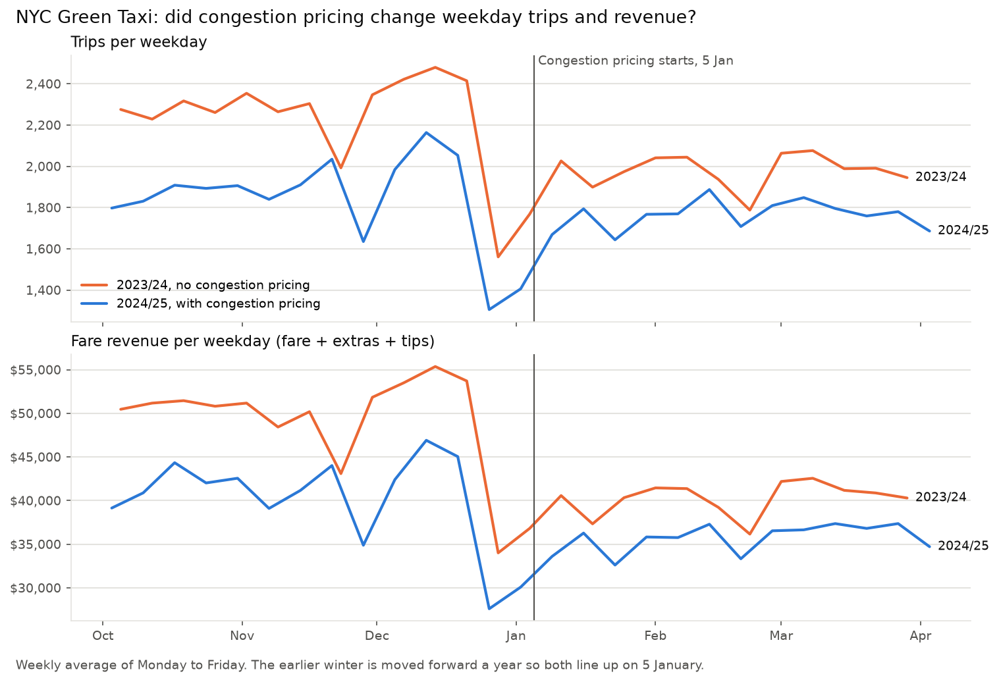
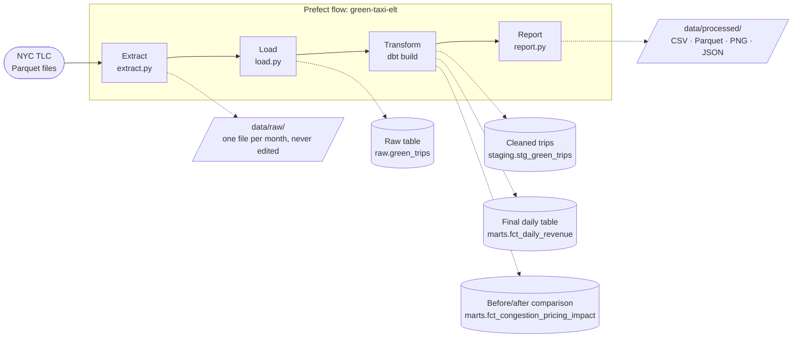
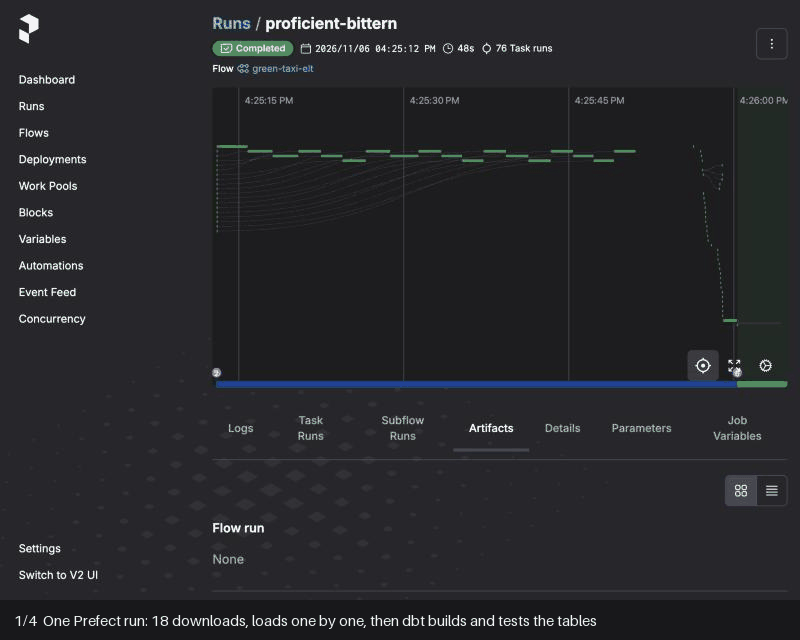

# NYC Taxi Congestion Pricing Pipeline

[](https://github.com/sean-mas/nyc-taxi-congestion-pricing-pipeline/actions/workflows/ci.yml)

A data pipeline that downloads NYC Green Taxi trip records, loads them into Postgres, turns them into revenue per day with dbt, and runs on a schedule with Prefect. It answers one question: did New York's congestion pricing change Green Taxi trips and revenue?

**Result:** congestion pricing (from 5 January 2025) left no visible mark on Green Taxi trips or revenue. The drop after 5 January is the usual winter dip, and it was smaller than the year before. Over 18 months (October 2023 to March 2025): 1,001,104 trips in 548 days, net revenue $24,157,147.48. The course quarter alone (January to March 2025): 90 days, net revenue $3,395,290.56.

[Context](#context) · [Results](#results) · [Quick start](#quick-start) · [How it works](#how-it-works) · [Decisions](docs/decisions.md) · [Tests](#tests-and-checks)

## Context

- **What it is:** the final project of the data pipeline module in the Machine Learning Engineering course by Spiced Academy (neuefische), built in November 2026.
- **The brief:** download the Green Taxi trip records for January to March 2025 into a local staging folder, then build an ETL or ELT pipeline that calculates revenue per day. Bonus: orchestrate it with Prefect.
- **What I added:** an ELT design (raw data in Postgres, cleaning in tested dbt SQL), checks that stop a run before a wrong number reaches the output, CI on every pull request, and a Prefect flow with retries, result tables in its web UI and a schedule. I then extended the pipeline from 3 to 18 months to answer a real question about congestion pricing.
- **Cross-check:** a classmate's independently built pipeline reached the same January to March numbers: 146,475 trips, 90 days, $3,395,290.56.
- **How it was built:** with [Claude Code](https://claude.com/claude-code) as an AI pair programmer. The choices and trade-offs behind it are in [docs/decisions.md](docs/decisions.md).

## Results

**Question:** on 5 January 2025, New York started congestion pricing: taxi passengers pay $0.75 per trip into Manhattan below 60th Street. Did it change Green Taxi trips and revenue?

**Answer: no sign that it did.** After 5 January, weekday trips fell 3.6% and fare revenue per day fell 10.6%. Over the same dates one year earlier, with no fee, they fell more: 10.5% and 17.3%. So the drop is the usual winter dip after the holidays. About 1 in 12 weekday trips paid the fee.



| Weekdays (Mon to Fri) | Before 5 Jan | After 5 Jan | Change | Change a year earlier, no fee |
|---|---:|---:|---:|---:|
| Trips per day | 1,834 | 1,768 | −3.6% | −10.5% |
| Fare revenue per day | $40,022 | $35,767 | −10.6% | −17.3% |
| Net revenue per day | $44,481 | $40,706 | −8.5% | −16.7% |
| Fare revenue per trip | $21.82 | $20.23 | −7.3% | −7.6% |
| Share of trips charged the fee | 0% | 8.3% | | 0% |

"Before" is 1 October 2024 to 4 January 2025, "after" is 5 January to 31 March 2025; the last column splits the winter before on 5 January 2024. Weekends show the same pattern: trips −12.6% against −14.4% a year earlier. **Net revenue** is everything passengers paid (`total_amount`), taxes and the fee included. **Fare revenue** is fare + extras + tips: what the driver and the taxi company keep.

Why compare with the year before: [decision 12](docs/decisions.md#12-compare-with-the-winter-before). What this can't tell you: [Limitations](#limitations).

## Quick start

You need [uv](https://docs.astral.sh/uv/) 0.13.5 or newer and [Docker Desktop](https://www.docker.com/products/docker-desktop/), running. No configuration file is needed.

```bash
uv sync
docker compose up -d --wait
uv run green-taxi run
```

The run downloads 18 monthly files (about 25 MB) and takes a minute or two. You should see this as the last line:

```text
INFO green_taxi.report: rows: 1,001,121 raw -> 1,001,104 in period -> 548 days; net revenue $24,157,147.48
```

The results are in `data/processed/`: daily revenue (CSV and Parquet), the congestion pricing comparison (CSV), two charts and `quality_report.json`. To check the course result for January to March 2025 only:

```bash
uv run green-taxi run --months 2025-01..2025-03
```

You should see `rows: 146,486 raw -> 146,475 in period -> 90 days; net revenue $3,395,290.56`. `--months` takes a list (`2025-01,2025-02`) or a range; the months must follow each other. Steps one at a time: `green-taxi download`, `load`, `transform`, `report`.

**With Prefect.** Run the same pipeline as a Prefect flow (it takes the same `--months` option). This works straight away: Prefect starts a temporary server for the run.

```bash
uv run python -m green_taxi.flow
```

To keep the run history and watch runs in the web UI (http://127.0.0.1:4200), start the server in its own terminal, point the project at it with the optional `.env` file, then run the flow, or serve it with a monthly schedule and a Run button in the UI:

```bash
uv run prefect server start
cp .env.example .env
uv run python -m green_taxi.flow --serve
```

## Tech stack and why

| Tool | What it does here, and why |
|---|---|
| [uv](https://docs.astral.sh/uv/) | Installs Python and the packages from one lock file, so every machine gets the same versions. |
| Postgres 17 in Docker | The database for the raw and cleaned tables. One command starts it; nothing else to install. |
| [dbt](https://docs.getdbt.com/) | SQL files that build tables in order and test them. A failing test stops the run. |
| [Prefect](https://docs.prefect.io/) | Runs the steps, retries failures, shows each run in a web UI. Downloads can fail for a moment; a retry usually fixes it. |
| pytest + ruff | pytest tests the Python code; ruff checks style and common mistakes. |
| GitHub Actions | Runs ruff and every test against a real Postgres on each pull request. |

## How it works



| Step | What happens | Where |
|---|---|---|
| 1. Extract | Downloads one Parquet file per month into `data/raw/`, reusing files already there. | [extract.py](src/green_taxi/extract.py) |
| 2. Load | Copies each file unchanged into `raw.green_trips`, adding the file name and load time. Each file's old rows are replaced in one transaction, so re-runs never duplicate data. | [load.py](src/green_taxi/load.py) |
| 3. Transform | dbt keeps the chosen months, renames and types the columns, flags refunds, builds the daily table and the before/after comparison, and runs 34 tests. | [dbt/](dbt/) |
| 4. Report | Counts rows at every stage and writes the outputs to `data/processed/`. | [report.py](src/green_taxi/report.py) |
| Orchestrate | The same functions as Prefect tasks: parallel downloads with 3 retries, each dbt table and test as its own task, and the results as tables in the Prefect UI. | [flow.py](src/green_taxi/flow.py) |

The raw data is stored first and cleaned with SQL afterwards (ELT, not ETL). That choice and the others are in [docs/decisions.md](docs/decisions.md).



## What the data needed

From exploring January to March 2025 in [the notebook](notebooks/01_explore_green_taxi.ipynb), then checking all 18 months:

| Finding | Rule |
|---|---|
| Some trips are dated outside their file's month (11 outside January to March 2025, e.g. 1 April) | Keep only pickups inside the period, so there's exactly one row per day |
| Some trips sit in a neighbouring month's file (62 in January to March 2025) | Count each trip on its pickup date, across all chosen files |
| Negative `total_amount`: refunds, disputes and voids (3,235 rows in 18 months, −$43,198.42) | Count them apart from trips: gross revenue, refunds, net revenue |
| $0 trips and trips without a `payment_type` whose amounts look normal | Keep them as trips |
| Trips over $500 (53 in 18 months, the largest $3,527.30) | Keep them, and list them in `quality_report.json` |
| Files before 2025 have no `cbd_congestion_fee` column | Create the raw table from a fixed column list |
| The fee appears only from 5 January 2025: 11,986 trips at $0.75 | A test fails if an earlier trip has it |
| The amount columns don't always add up to `total_amount` (about 14% of rows) | Add up fare revenue from its own three columns |
| No duplicate rows | No deduplication step |

## Limitations

- **Revenue isn't profit.** Net revenue is `total_amount`: what passengers paid, including taxes, tolls and surcharges that go to the city, the state and the MTA. Fare revenue leaves those out, but neither subtracts any costs. Cash tips aren't recorded in the data at all; only card tips are.
- **The results describe the published files.** Trips the TLC didn't publish, or corrects later, aren't reflected until the files change.
- **The congestion pricing comparison covers two winters.** Other things changed between them: Green Taxi weekday trips were already 17% lower than a year earlier before the fee (the fleet keeps shrinking), the weather differs, and holidays fall on different weekdays. So "no sign of an effect" is the honest reading; the smaller dip in 2024/25 can't be credited to the fee either.
- **It's about Green Taxis only.** They can't pick up street hails in Manhattan below West 110th and East 96th Street, so most of their trips never enter the fee zone. It says nothing about yellow cabs or ride-hailing apps.
- **The schedule re-runs a fixed period.** The `monthly` deployment processes the same months every time; it doesn't add new months as the TLC publishes them.
- **Prefect runs locally.** Without the server and `.env`, each run uses a temporary Prefect server and its history is gone afterwards. Scheduled runs only happen while `--serve` keeps running in a terminal.

## Tests and checks

Run them with `uv run pytest`. The integration tests need the Postgres container and use a separate `green_taxi_test` database.

- **Unit tests** ([extract](tests/test_extract.py), [months](tests/test_months.py), [command line](tests/test_cli.py), [settings](tests/test_config.py)): download links, reusing files and failed downloads without any network calls; month lists and ranges; months with a gap stop a run before anything is downloaded; the database settings work without a `.env` file.
- **Integration tests** ([load](tests/test_load.py), [end to end](tests/test_pipeline_e2e.py)): a file without the fee column loads before one with it, and an unknown column is rejected. Nine hand-made trips (a refund, a $0 trip, a missing payment type, one outside the period, trips with and without the fee on both sides of 5 January) go through load, dbt and report, and the exact daily rows and weekday comparison are checked. Files from months that weren't chosen don't count.
- **dbt tests** (on every run): one row per day, no missing values, no day outside the period, totals that match the cleaned trips to the cent, every compared day counted once, and no fee before 5 January 2025.
- **CI** ([workflow](.github/workflows/ci.yml)): ruff and all tests on every pull request.

## Project structure

```
├── assets/              # charts and the Prefect demo used in this README
├── data/raw/            # downloaded files (not in git)
├── data/processed/      # outputs (not in git)
├── dbt/
│   ├── models/          # staging: cleaned trips; marts: final tables
│   ├── seeds/           # the two winters compared, as a CSV
│   └── tests/           # reconciliation and fee checks
├── docs/decisions.md    # why the pipeline is built this way
├── notebooks/           # exploration only, not part of the pipeline
├── src/green_taxi/      # extract, load, transform, report, CLI and Prefect flow
└── tests/
```

<details>
<summary>Course reflection (3 review questions)</summary>

**1. What are the steps you took to complete the project?**
- Planned the pipeline first: ELT with Postgres and dbt, orchestrated with Prefect, delivered as small pull requests.
- Set up the repo as an installable Python package, with Postgres in Docker.
- Wrote the download script, then explored January to March 2025 in a notebook to decide the cleaning rules.
- Loaded the raw files unchanged into Postgres, then built the dbt models (cleaned trips, daily revenue) with tests that run on every pipeline run.
- Added a report step that checks row counts at every stage, then wrapped everything in a Prefect flow with retries, result tables in the Prefect UI and a monthly schedule.
- Checked my result against a classmate's independently built pipeline: the same 146,475 trips, 90 days and $3,395,290.56.
- Extended the pipeline to 18 months to answer a real question: did congestion pricing change Green Taxi trips and revenue?

**2. What challenges did you face?**
- Deciding what "revenue" means: refunds appear as negative rows, so I report gross revenue, refunds and net revenue separately. Later I added fare revenue, because `total_amount` includes taxes and surcharges.
- Trips dated outside their month: 11 fall outside the quarter, and counting them would report 94 days instead of 90.
- Making re-runs safe: the course's loader replaces the whole table, so only the last month loaded survives. Replacing each file's rows in one transaction fixed it.
- Older files don't have the congestion fee column, so the raw table needed a fixed column list.
- Tooling: a dbt dependency wouldn't install (a GitHub timeout), so I pinned the version the course uses. Prefect didn't show my own log lines until I set their log level.

**3. What would you do differently if you had more time?**
- Make Prefect production-ready. At the start I chose between running Prefect locally and a production-like setup, and picked local because of the deadline. The next step: the Prefect server and a worker in Docker, a work pool, and `flow.deploy()` with the pipeline packaged as a Docker image, so runs no longer depend on a terminal on my laptop. Plus an alert when a run fails.
- Load incrementally: fetch new months as the TLC publishes them, instead of re-running a fixed period.
- Break revenue down by borough and payment type with a taxi-zone lookup.
- Publish the dbt docs (a lineage graph of the tables) and add a small dashboard.
- Use Postgres `COPY` for faster loads at larger volumes.

</details>
