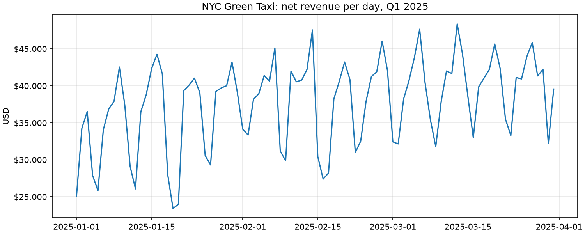
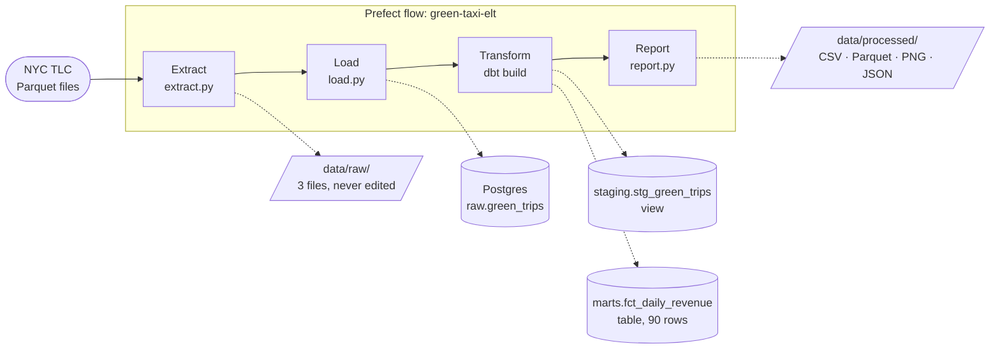
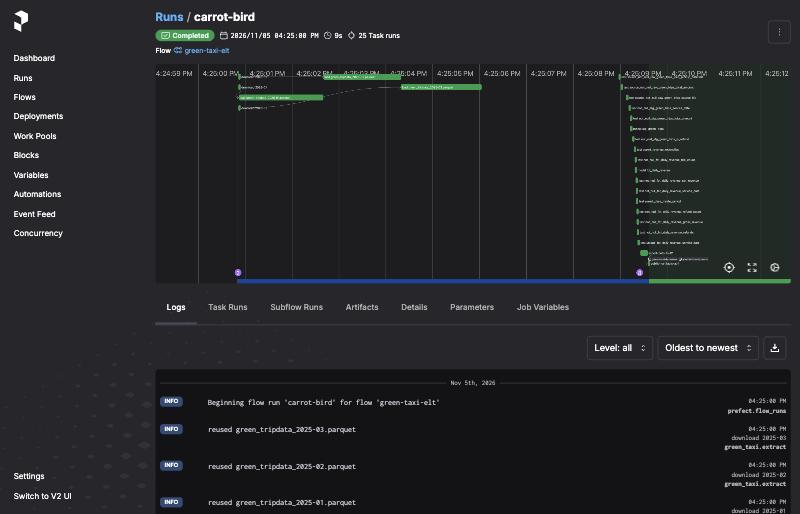

# NYC Green Taxi: daily revenue pipeline

[](https://github.com/sean-mas/mle-data-pipeline-project/actions/workflows/ci.yml)

An **ELT pipeline**, orchestrated with **Prefect**, that downloads the NYC Green Taxi trip records for January to March 2025, loads them unchanged into Postgres, and uses dbt to calculate revenue per day. It's the Spiced/neuefische data pipeline project; the original brief is in [course/project-brief.md](course/project-brief.md).

**Result:** 146,486 trip records → 146,475 in the period → **90 days**, net revenue **$3,395,290.56** (gross $3,401,753.17, refunds −$6,462.61). Every step is tested, and running the pipeline twice gives the same numbers.



## How it works



| Step | What happens | Where |
|---|---|---|
| 1. Extract | Downloads one Parquet file per month into `data/raw/`. Files already there are reused; an interrupted download is never mistaken for a finished one. | [extract.py](src/green_taxi/extract.py) |
| 2. Load | Copies each file unchanged into `raw.green_trips`, plus `source_file` and `loaded_at`. One transaction per file deletes that file's old rows first, so re-runs never duplicate data. | [load.py](src/green_taxi/load.py) |
| 3. Transform | dbt builds a staging view (renamed, typed, Q1 2025 only, refunds flagged) and the daily revenue table, then runs 15 data tests. A failing test stops the pipeline. | [dbt/models/](dbt/models/) |
| 4. Report | Counts rows at every stage and writes the result as CSV, Parquet, a chart and `quality_report.json`. | [report.py](src/green_taxi/report.py) |
| Orchestrate | The same functions as Prefect tasks: parallel downloads with 3 retries, every dbt model and test as its own task, and the result table plus a row-count report in the Prefect UI. A `monthly` deployment runs on a schedule or from a Run button. | [flow.py](src/green_taxi/flow.py) |



### Why ELT and not ETL

- **ETL** (extract, transform, load) cleans the data in Python *before* it's stored. The reference solution in `solution/` works this way with pandas.
- **ELT** (extract, load, transform) stores the raw data *first*, then cleans it with SQL inside the database.

This pipeline uses ELT because:
- The raw copy in Postgres stays untouched, so a cleaning rule can change and be re-run in SQL without downloading again.
- dbt splits the SQL into layers (raw → staging → mart) and tests each one. This is how analytics teams usually work.
- Every row can be traced back to its source file.

## What the data needed

Findings from [notebooks/01_explore_green_taxi.ipynb](notebooks/01_explore_green_taxi.ipynb), and the rule each one led to:

| Finding | Rule |
|---|---|
| 11 trips are dated outside Jan 1 to Mar 31, 2025 (some in December 2024, some on April 1) | Keep only pickups in the period, so the result has exactly 90 days. Without this rule there would be 94 |
| 62 more trips sit in a neighbouring month's file (e.g. a Jan 31 trip in the February file) | Group by pickup date across all files, not per file |
| 478 rows have a negative `total_amount` (refunds, disputes, voids), −$6,462.61 in total | Count them apart from trips: `gross_revenue`, `refunds`, `net_revenue` |
| 254 trips have a `total_amount` of $0 | Count them as trips with no revenue |
| 7,902 trips have no `payment_type`, but their amounts look normal | Keep them |
| 2 trips are over $500 (max $642.14) | Keep them, and list them in the quality report |
| No duplicate rows | No deduplication step |

**Revenue definition:** `net_revenue` for a day is the sum of `total_amount` (fare, extras, taxes, tip, tolls and surcharges) for trips picked up that day, refunds included.

## Results

| Month | Days | Trips | Net revenue |
|---|---:|---:|---:|
| January 2025 | 31 | 48,136 | $1,092,994.80 |
| February 2025 | 28 | 46,479 | $1,067,222.12 |
| March 2025 | 31 | 51,382 | $1,235,073.64 |
| **Total** | **90** | **145,997** | **$3,395,290.56** |

- Average day: $37,725. Busiest day: Thursday, March 13 ($48,362). Quietest: Sunday, January 19 ($23,401).
- Weekdays earn more than weekends: Thursdays average $43,454, Sundays $30,005.

## Project structure

```
├── data/raw/                 # staged downloads (not in git)
├── data/processed/           # daily revenue outputs (not in git)
├── dbt/                      # transform layer: staging and mart models, tests
├── notebooks/                # exploration only, not part of the pipeline
├── src/green_taxi/
│   ├── config.py             # months, source URL, paths, database settings
│   ├── extract.py            # step 1
│   ├── load.py               # step 2
│   ├── transform.py          # step 3 (runs dbt)
│   ├── report.py             # step 4
│   ├── pipeline.py           # plain CLI: green-taxi download | load | transform | report | run
│   └── flow.py               # Prefect flow and deployment
├── tests/                    # unit tests (extract) and integration tests (load, end to end)
├── docker-compose.yaml       # Postgres 17 on port 5433
├── course/                   # original project brief
└── solution/                 # the course's ETL reference solution, untouched
```

## How to run

Needs [uv](https://docs.astral.sh/uv/) 0.13.5+ and Docker Desktop.

```bash
uv sync
cp .env.example .env
docker compose up -d --wait
```

Run the plain pipeline (no Prefect):

```bash
uv run green-taxi run
```

Or one step at a time: `green-taxi download`, `load`, `transform`, `report`. Outputs land in `data/processed/`.

Run it with Prefect. Start the server in its own terminal and keep it open (UI at http://127.0.0.1:4200):

```bash
uv run prefect server start
```

Then run the flow once:

```bash
uv run python -m green_taxi.flow
```

Or serve it as the `monthly` deployment, with a schedule and a Run button in the UI:

```bash
uv run python -m green_taxi.flow --serve
```

Run the tests (the integration tests need the Postgres container):

```bash
uv run pytest
```

> [!NOTE]
> `.env` sets `PREFECT_API_URL` to the local server. If the server isn't running, Prefect runs fail with "Failed to reach API". Start the server first.

## Tests and checks

- **Unit tests** ([tests/test_extract.py](tests/test_extract.py)): URL building, month validation, reusing staged files and failed downloads, without any network calls.
- **Integration tests** ([tests/test_load.py](tests/test_load.py), [tests/test_pipeline_e2e.py](tests/test_pipeline_e2e.py)): six hand-made trips (a refund, a $0 trip, a missing payment type, one from 2024) go through load → dbt → report against a separate `green_taxi_test` database, and the exact daily rows are checked.
- **dbt tests** (run on every pipeline run): one row per day, no missing values, no day outside the period, and mart totals that match staging to the cent.
- **CI** ([.github/workflows/ci.yml](.github/workflows/ci.yml)): ruff lint and format checks plus all tests against Postgres on every pull request.

## Answers to the project questions

> **Draft notes, not final answers.** Sean: rewrite these in your own words before submitting.

**1. What are the steps you took to complete the project?**
- Set up the repo as an installable package, with Postgres in Docker Compose and one `.env` for Python, dbt and Prefect.
- Wrote the download script (step 1), then explored one quarter of data in a notebook to decide the cleaning rules.
- Loaded the raw files unchanged into Postgres, then built the dbt staging and daily revenue models with tests.
- Added a report step that reconciles row counts, then wrapped everything in a Prefect flow with retries, artifacts and a schedule.
- Delivered it as a series of small pull requests, each with tests.

**2. What challenges did you face?**
- Deciding what "revenue" means: refunds appear as negative rows, so I report gross, refunds and net separately.
- Trips dated outside their month: 11 fall outside the quarter entirely, and the reference solution's approach would report 94 days instead of 90.
- Making re-runs safe: the course loader replaces the table, which keeps only the last month loaded. Delete-and-insert per file fixed it.
- Tooling: a dbt dependency failed to install (GitHub timeout), so I pinned the version the course uses. Prefect didn't show my own log lines until I set their log level.

**3. What would you do differently if you had more time?**
- Run Prefect like production: server and worker in Docker, a work pool, and `flow.deploy()` instead of `serve()`.
- Make loads incremental, so only new months are fetched, and extend the pipeline to more months and years.
- Add a taxi-zone lookup and payment-type seed to break revenue down by borough and payment method.
- Publish dbt docs (a lineage graph) and add a small dashboard.
- Use Postgres `COPY` for faster loads at larger volumes, and set up a Prefect alert for failed runs.
