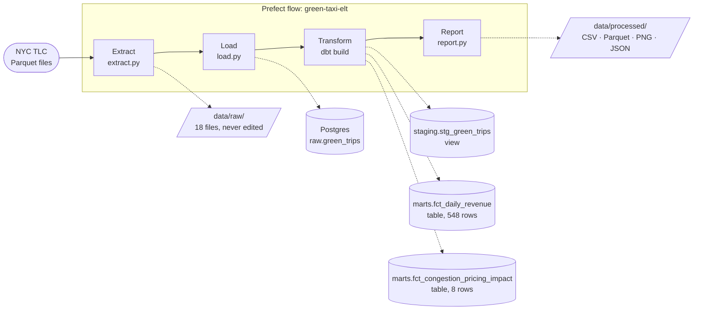

# NYC Green Taxi: did congestion pricing change trips and revenue?

[](https://github.com/sean-mas/mle-data-pipeline-project/actions/workflows/ci.yml)

An **ELT pipeline**, orchestrated with **Prefect**, that downloads 18 months of NYC Green Taxi trip records (October 2023 to March 2025), loads them unchanged into Postgres, and uses **dbt** to calculate revenue per day and answer one question about it.

It started as the final project of the Spiced Academy (neuefische) data pipeline course, which asked for daily revenue for January to March 2025 ([brief](course/project-brief.md)), and was then extended to answer a real question.

## Findings

**Question:** On 5 January 2025, New York started congestion pricing: taxi passengers pay $0.75 per trip into Manhattan below 60th Street. Did it change Green Taxi trips and revenue?

**Answer: no sign that it did.** After 5 January, weekday trips fell 3.6% and fare revenue per day fell 10.6%. But over the same dates one year earlier, with no fee, they fell even more: −10.5% and −17.3%. The drop is the usual winter dip after the holidays. Revenue per trip moved just as it did the year before (−7.3% against −7.6%). About 1 in 12 weekday trips (8.3%) paid the fee.


Weekdays (Monday to Friday). "Before" is 1 October 2024 to 4 January 2025, "after" is 5 January to 31 March 2025. The last column splits the winter before on 5 January 2024 in the same way.

| Weekdays | Before | After | Change | Change a year earlier, no fee |
|---|---:|---:|---:|---:|
| Trips per day | 1,834 | 1,768 | −3.6% | −10.5% |
| Fare revenue per day (fare + extras + tips) | $40,022 | $35,767 | −10.6% | −17.3% |
| Net revenue per day (`total_amount`) | $44,481 | $40,706 | −8.5% | −16.7% |
| Fare revenue per trip | $21.82 | $20.23 | −7.3% | −7.6% |
| Share of trips charged the fee | 0% | 8.3% | | 0% |

Weekends show the same pattern: trips −12.6% against −14.4% a year earlier, and 9.2% of trips paid the fee.

**How to read it**

- **Why compare with the year before?** Taxi demand always drops after the holidays. A plain before/after comparison would blame the fee for that dip. Splitting the winter before on the same date shows how big the normal dip is, so the fee's effect is the *difference* between the two changes. (Analysts call this a difference-in-differences.)
- **Why weekdays apart from weekends?** They have different trip patterns, and the before and after periods don't hold the same mix of them.
- **Why two revenue measures?** `total_amount` includes taxes, tolls and surcharges that are passed on to the city, the state and the MTA, now including the $0.75 fee itself. `fare_revenue` (fare + extras + tips) is what the driver and the taxi company keep, so the fee can't inflate it.

**Limits**

- Two winters are a small sample, and other things changed between them. Green Taxi weekday trips were already 17% lower than a year earlier *before* the fee, because the fleet keeps shrinking. The weather differs, and holidays fall on different weekdays. So the smaller dip in 2024/25 can't be credited to the fee either.
- Green Taxis can't pick up street hails in Manhattan below West 110th and East 96th Street, so most of their trips never enter the zone. A small effect was the likely outcome.
- This covers Green Taxis only. It says nothing about yellow cabs or ride-hailing apps.

The numbers come from `marts.fct_congestion_pricing_impact` ([SQL](dbt/models/marts/fct_congestion_pricing_impact.sql)). Every run writes them to `data/processed/congestion_pricing_comparison.csv` and redraws the chart.

## How it works



| Step | What happens | Where |
|---|---|---|
| 1. Extract | Downloads one Parquet file per month into `data/raw/`. Files already there are reused; an interrupted download is never mistaken for a finished one. | [extract.py](src/green_taxi/extract.py) |
| 2. Load | Copies each file unchanged into `raw.green_trips`, plus `source_file` and `loaded_at`. The table has a fixed column list, so files with and without the 2025 fee column fit into it. One transaction per file deletes that file's old rows first, so re-runs never duplicate data. | [load.py](src/green_taxi/load.py) |
| 3. Transform | dbt builds a staging view (renamed, typed, only the chosen months, refunds flagged), the daily revenue table and the congestion pricing comparison, then runs 34 data tests. A failing test stops the pipeline. The months on the command line set the period dbt keeps. | [dbt/](dbt/) |
| 4. Report | Counts rows at every stage and writes the results as CSV, Parquet, two charts and `quality_report.json`. | [report.py](src/green_taxi/report.py) |
| Orchestrate | The same functions as Prefect tasks: parallel downloads with 3 retries, every dbt model and test as its own task, and the daily table, the congestion pricing comparison and a row-count report in the Prefect UI. A `monthly` deployment runs on a schedule or from a Run button. | [flow.py](src/green_taxi/flow.py) |


### Why ELT and not ETL

- **ETL** (extract, transform, load) cleans the data in Python *before* it's stored. The reference solution in `solution/` works this way with pandas.
- **ELT** (extract, load, transform) stores the raw data *first*, then cleans it with SQL inside the database.

This pipeline uses ELT because:
- The raw copy in Postgres stays untouched, so a cleaning rule can change and be re-run in SQL without downloading again.
- dbt splits the SQL into layers (raw → staging → marts) and tests each one. This is how analytics teams usually work.
- Every row can be traced back to its source file.

## What the data needed

Findings from exploring January to March 2025 in [notebooks/01_explore_green_taxi.ipynb](notebooks/01_explore_green_taxi.ipynb), and the rule each one led to:

| Finding | Rule |
|---|---|
| 11 trips are dated outside Jan 1 to Mar 31, 2025 (some in December 2024, some on April 1) | Keep only pickups in the period, so the result has exactly one row per day |
| 62 more trips sit in a neighbouring month's file (e.g. a Jan 31 trip in the February file) | Group by pickup date across all files, not per file |
| 478 rows have a negative `total_amount` (refunds, disputes, voids), −$6,462.61 in total | Count them apart from trips: `gross_revenue`, `refunds`, `net_revenue` |
| 254 trips have a `total_amount` of $0 | Count them as trips with no revenue |
| 7,902 trips have no `payment_type`, but their amounts look normal | Keep them |
| 2 trips are over $500 (max $642.14) | Keep them, and list them in the quality report |
| No duplicate rows | No deduplication step |

Extending the window to 18 months for the congestion pricing question added these:

| Finding | Rule |
|---|---|
| Files before 2025 have no `cbd_congestion_fee` column; all other columns and types match across the 18 files | Create the raw table from a fixed column list. A missing column loads as NULL; an unknown column stops the load, so a new TLC column is a decision, not a surprise |
| The fee appears only from 5 January 2025: 11,986 trips at $0.75, one refund at −$0.75 | A dbt test fails if any earlier trip has the fee |
| The amount columns don't always add up to `total_amount` (about 14% of rows, most of them a $1.00 gap in one vendor's MTA tax) | Build `fare_revenue` from its own three columns instead of subtracting taxes from the total |
| Over 18 months: 17 trips dated outside the period, 3,235 refund rows (−$43,198.42), 53 trips over $500 (max $3,527.30) | Same rules as above; the large trips are listed in `quality_report.json` |

**Revenue definitions:** for each pickup day, `net_revenue` is the sum of `total_amount` (fare, extras, taxes, tip, tolls and surcharges), and `fare_revenue` is the sum of fare + extras + tip. Both include refunds.

## Results

1,001,121 trip records → 1,001,104 in the period → **548 days**, net revenue **$24,157,147.48** (gross $24,200,345.90, refunds −$43,198.42), fare revenue **$21,714,266.83**. Every step is tested, and running the pipeline twice gives the same numbers.

| Quarter | Days | Trips | Net revenue | Fare revenue |
|---|---:|---:|---:|---:|
| Q4 2023 | 92 | 193,830 | $4,741,915.10 | $4,286,582.36 |
| Q1 2024 | 91 | 167,027 | $3,795,657.09 | $3,407,243.78 |
| Q2 2024 | 91 | 171,594 | $4,179,453.14 | $3,762,259.36 |
| Q3 2024 | 92 | 157,524 | $4,080,442.06 | $3,691,650.57 |
| Q4 2024 | 92 | 161,886 | $3,964,117.01 | $3,571,513.12 |
| Q1 2025 | 90 | 146,008 | $3,395,563.08 | $2,995,017.64 |
| **Total** | **548** | **997,869** | **$24,157,147.48** | **$21,714,266.83** |

Q1 2025 is $272.52 (11 trips) higher than the course result of $3,395,290.56: those January trips sit in the December 2024 file, which the course run didn't load.


## Project structure

```
├── data/raw/                 # staged downloads (not in git)
├── data/processed/           # outputs (not in git)
├── dbt/
│   ├── models/staging/       # stg_green_trips: renamed, typed, filtered to the period
│   ├── models/marts/         # fct_daily_revenue, fct_congestion_pricing_impact
│   ├── seeds/                # congestion_pricing_windows.csv: the two winters compared
│   └── tests/                # reconciliation and fee checks
├── notebooks/                # exploration only, not part of the pipeline
├── src/green_taxi/
│   ├── config.py             # default months, source URL, paths, database settings
│   ├── months.py             # --months parsing and the period dbt keeps
│   ├── extract.py            # step 1
│   ├── load.py               # step 2
│   ├── transform.py          # step 3 (runs dbt)
│   ├── report.py             # step 4
│   ├── pipeline.py           # plain CLI: green-taxi download | load | transform | report | run
│   └── flow.py               # Prefect flow and deployment
├── tests/                    # unit tests (extract, months, CLI) and integration tests (load, end to end)
├── docker-compose.yaml       # Postgres 17 on port 5433
├── course/                   # original project brief and the course answers
├── solution/                 # the course's ETL reference solution, untouched
└── PORTFOLIO.md              # what to change before making the repo public
```

## How to run

Needs [uv](https://docs.astral.sh/uv/) 0.13.5+ and Docker Desktop.

```bash
uv sync
cp .env.example .env
docker compose up -d --wait
```

Run the plain pipeline (no Prefect). Without `--months` it processes October 2023 to March 2025:

```bash
uv run green-taxi run
```

Pick other months as a list (`2025-01,2025-02`) or a range. The months must follow each other without gaps:

```bash
uv run green-taxi run --months 2024-10..2025-03
```

Or one step at a time: `green-taxi download`, `load`, `transform`, `report`. Outputs land in `data/processed/`.

Run it with Prefect. Start the server in its own terminal and keep it open (UI at http://127.0.0.1:4200):

```bash
uv run prefect server start
```

Then run the flow once (it takes the same `--months` option):

```bash
uv run python -m green_taxi.flow
```

Or serve it as the `monthly` deployment, with a schedule and a Run button in the UI:

```bash
uv run python -m green_taxi.flow --serve
```

Run the tests (the integration tests need the Postgres container):

```bash
uv run pytest
```

> [!NOTE]
> `.env` sets `PREFECT_API_URL` to the local server. If the server isn't running, Prefect runs fail with "Failed to reach API". Start the server first.

## Tests and checks

- **Unit tests** ([tests/test_extract.py](tests/test_extract.py), [tests/test_months.py](tests/test_months.py), [tests/test_cli.py](tests/test_cli.py)): URL building, reusing staged files and failed downloads without any network calls; month lists, ranges and the period; months with a gap stop a run before anything is downloaded.
- **Integration tests** ([tests/test_load.py](tests/test_load.py), [tests/test_pipeline_e2e.py](tests/test_pipeline_e2e.py)): a file without the fee column can load before one with it, and an unknown column is rejected. Nine hand-made trips (a refund, a $0 trip, a missing payment type, one outside the period, trips with and without the fee on both sides of 5 January) go through load → dbt → report against a separate `green_taxi_test` database, and the exact daily rows and weekday comparison are checked.
- **dbt tests** (run on every pipeline run): one row per day, no missing values, no day outside the period, mart totals that match staging to the cent (net and fare revenue), every compared day counted exactly once, and no congestion fee before 5 January 2025.
- **CI** ([.github/workflows/ci.yml](.github/workflows/ci.yml)): ruff lint and format checks plus all tests against Postgres on every pull request.
